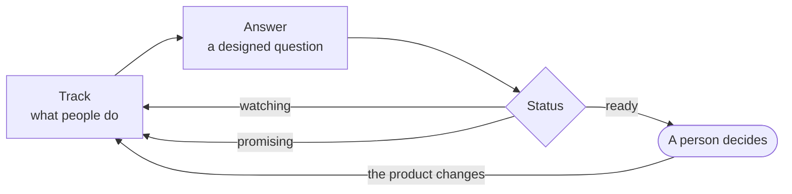
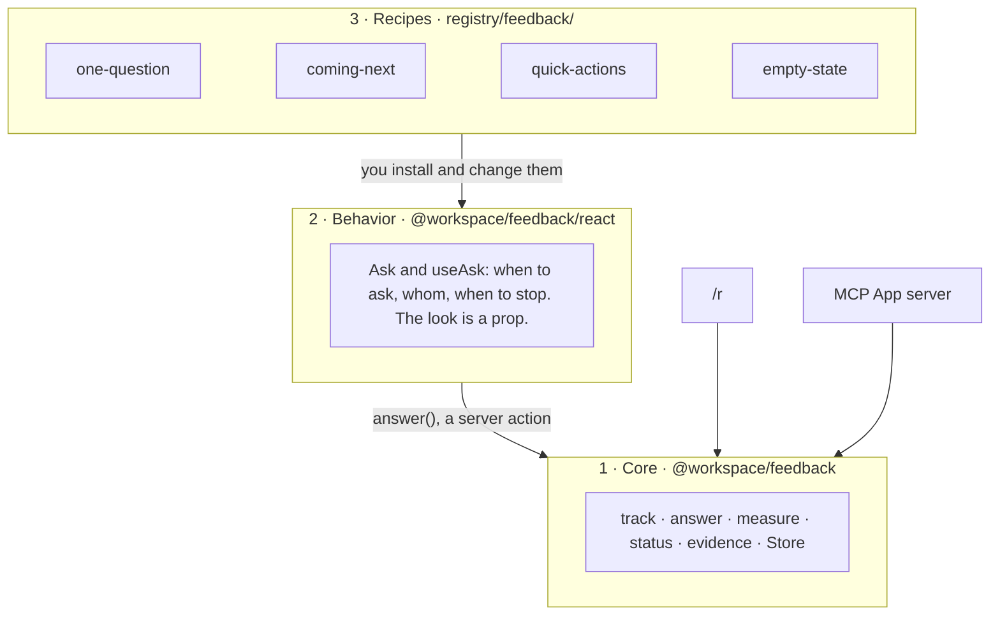

# `packages/feedback`

The Feedback Loop for registry.directory: **Observe → Ask → Improve**. It
tracks what people do and what they answer, and tells you, feature by feature,
whether it's time to decide something.

> **Draft.** We're still designing, and this file gets rewritten as decisions
> close. No code yet. What it does, what it doesn't, its invariants and who
> uses it are settled; the exact signatures, options and the table are a
> proposal.

## The loop



| Idea | In code | What it is |
|---|---|---|
| Observe | `feedback.track` | What people do, recorded without interrupting them. |
| Ask | `feedback.answer`, and the `Ask` component | The answer to something designed on purpose: a thumbs up, an "I want this". |
| Improve | `measure`, `feedback.status`, `feedback.evidence` | Each feature declares what it tracks, what it asks and its goal. `status` says where it stands. **A person decides** what changes. |

The three states:

- **`watching`:** only one side moves (people install, but nobody answers, or
  the other way around).
- **`promising`:** both sides move, but not to the goal yet.
- **`ready`:** both sides reach the goal, in more than one week. It's a
  heads-up for a person, never a trigger.

## One feature, end to end

"Find me a component" in the MCP App: someone searches, installs, and is
asked whether it fit. The goal values are examples.

**1. Measure the feature**

```ts
measure("find-component", {
  question: "Do people find what they need?",
  track: "install",
  answer: { name: "did-it-fit", value: "yes" },
  goal: { installs: 50, fits: 30, weeks: 2 },
})
```

**2. Track the install** (the MCP App server, after it installs)

```ts
after(() => feedback.track("install", { subject: "acme/pricing-compare", teamId }))
```

**3. Ask, with the team's own look**

```tsx
<Ask
  feature="find-component"
  question="Did it fit what you needed?"
  when={{ once: "week", stopWhen: "ready" }}
  render={Thumbs}
/>
```

`Thumbs` is the team's component. It receives `{ question, answer }` and calls
`answer("yes")` or `answer("no")`. That `answer` is a server action that calls
`feedback.answer("did-it-fit", value, { subject, teamId })`.

**4. What Analytics shows**

```
Find me a component · "Do people find what they need?"
  62 installs · 34 fits · 2 weeks        → ready
  62 installs · 12 fits · 2 weeks        → promising
```

In the second case people install, but it isn't clear they find what they
were looking for.

## Behavior, not look



The package never decides how anything looks, so it plugs into anyone's design
system instead of competing with it.

1. **The core, `@workspace/feedback`.** No React, no Next.js. `/r`, scripts
   and the server use it.
2. **Behavior, `@workspace/feedback/react`.** React only: no styles, no
   Next.js. `Ask` decides whether to ask this person now, records the answer
   and feeds Analytics. Options for `when` (proposal): `once`, at most once
   per person per period; `stopWhen: "ready"`, stop asking once there's
   enough evidence; and `max`, a cap on answers.
3. **Recipes, as shadcn registry items.** Complete flows built with `Ask`.
   Install one with `npx shadcn add @registrydirectory/feedback/<item>` and
   make it yours. The Dashboard uses these same recipes:
   - `one-question`: the right question at the right moment, with a thumbs
     component as its `render`;
   - `coming-next`: what doesn't exist yet, greyed out and apart from what
     works today, with one line on what it will do and an "I want this"
     button. No email, no dates;
   - `quick-actions`: the phrase buttons of an empty state;
   - `empty-state`: an empty screen that asks instead of sitting blank.

`@workspace/...` are the package's names inside this monorepo.
`@registrydirectory/feedback/<item>` is the shadcn registry namespace the
recipes install from, not an npm package.

## What it doesn't do

- **Decide how anything looks.** The visible part is always the team's.
- **Change the product.** `ready` is a heads-up, never an automatic change.
- **Store personal data.** No IP addresses, raw user agents or emails.
- **Know about permissions.** The caller filters what each person may see.
  Access lives in [`packages/organizations`](../organizations).
- **Replace Vercel Analytics** on the public site.

## Core API (proposal)

```ts
const feedback = createFeedback({ store })

feedback.track(name, { subject, teamId, props })
feedback.answer(name, answer, { subject, teamId })

measure(feature, { question, track, answer, goal })
feedback.status(feature)   // "watching" | "promising" | "ready"
feedback.evidence(feature) // the dated weeks behind that status
```

- Analytics reads `status`, and `evidence` when a person opens a feature in
  `ready` before deciding. There is no public API for raw aggregates.
- The app keeps one `measure()` per feature, in `apps/web/feedback/features/`.
- **Store:** an interface with `write(event)` and `aggregate(query)`. The
  Postgres store uses one table: `feedback_event(id, at, kind, name, subject,
  team_id, props)`, where `kind` is `track` or `answer`.

## Depends on and used by

- **Depends on:** a Store. Postgres is the first one.
- **Used by:** `/r` (tracks installs), `apps/web` (empty-state clicks, "I want
  this" in Coming next, Save to team, and the Analytics screen) and the MCP
  App (search, preview and install).

Working on this package? Read [`AGENTS.md`](AGENTS.md) first.
