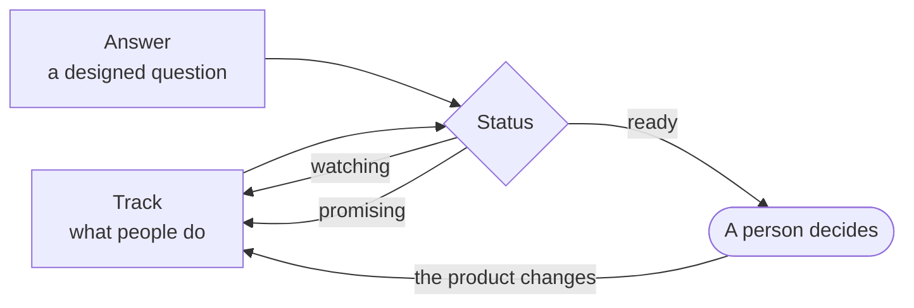

# `packages/feedback`

The Feedback Loop for registry.directory: **Observe → Ask → Improve**. It
tracks what people do and what they answer, and tells you, feature by feature,
when it's time for a person to decide something.

> **Draft.** We're still designing, and this file gets rewritten as decisions
> close. No code yet: the examples show the intended API, and its exact
> signatures are a proposal.



Track and answer come in separately: someone can install without answering,
or say "I want this" without installing anything. And `ready` never changes
anything by itself; it ends with a person.

## Setting it up

The core has no React and no Next.js, so `/r`, scripts and the server use it
directly. You give it a Store; Postgres is the first one:

```ts
import { createFeedback } from "@workspace/feedback"

export const feedback = createFeedback({ store: postgresStore(db) })
```

## Measuring a feature

Each feature declares what it tracks, what it asks and its goal. The app keeps
one `measure()` per feature, in `apps/web/feedback/features/`:

```ts
import { measure } from "@workspace/feedback"

export default measure("find-component", {
  question: "Do people find what they need?",
  track: "install",
  answer: { name: "did-it-fit", value: "yes" },
  goal: { installs: 50, fits: 30, weeks: 2 },
})
```

The values in `measure()` are the defaults. They can be changed later without
touching this file (see below).

## Tracking what people do

Track without making anyone wait. In `/r`, the install is recorded after the
response, when the CLI fetches the item:

```ts
after(() => feedback.track("install", { subject: "acme/pricing-compare", teamId }))
```

If recording fails, it logs and the response goes on. Never put an IP address,
a raw user agent or an email in `props`.

## Asking a question

`Ask` lives in `@workspace/feedback/react`. It decides whether to ask this
person now, records the answer and feeds Analytics. How it looks is up to you:
pass your own component as `render`.

```tsx
import { Ask } from "@workspace/feedback/react"

<Ask
  feature="find-component"
  question="Did it fit what you needed?"
  when={{ once: "week", stopWhen: "ready" }}
  render={Thumbs}
/>
```

Your component receives `{ question, answer }` and only knows how it looks:

```tsx
function Thumbs({ question, answer }) {
  return (
    <div>
      <p>{question}</p>
      <Button onClick={() => answer("yes")}>👍</Button>
      <Button onClick={() => answer("no")}>👎</Button>
    </div>
  )
}
```

`answer` is a server action that calls
`feedback.answer("did-it-fit", value, { subject, teamId })`. It's the only way
from the component to the core: neither `Ask` nor your component touches the
database.

The `when` options are a proposal: `once`, at most once per person per period;
`stopWhen: "ready"`, stop asking once there's enough evidence; and `max`, a
cap on answers.

## Reading the status

```ts
await feedback.status("find-component")   // "watching" | "promising" | "ready"
await feedback.evidence("find-component") // the dated weeks behind that status
```

- **`watching`:** only one side moves.
- **`promising`:** both sides move, but not to the goal yet.
- **`ready`:** both sides reach the goal, in more than one week.

The Analytics screen shows it like this:

```
Find me a component · "Do people find what they need?"
  62 installs · 34 fits · 2 weeks        → ready
  62 installs · 12 fits · 2 weeks        → promising
```

In the second case people install, but it isn't clear they find what they were
looking for. When a feature reaches `ready`, a person opens its evidence and
decides. There's no public API for raw aggregates.

## Defaults you can change

`measure()` ships the defaults: the question, the goal and `when`. Changes are
stored as data, so nobody needs a deploy to adjust them:

```ts
await feedback.settings("find-component").set({ // proposal
  goal: { installs: 80, fits: 40, weeks: 2 },
})

await feedback.settings("find-component").get()
// the effective value
```

The effective value is the team's setting if there is one, then the
platform's, then the default in `measure()`. `Ask` and `status` always read
the effective value. Who can change what is a proposal: the platform Admin
adjusts goals and questions from Analytics; a team Owner can adjust how often
their team is asked and the wording it sees, never the platform's goals.

## Recipes

If you'd rather start from something finished, install a recipe and make it
yours:

```bash
npx shadcn add @registrydirectory/feedback/coming-next
```

`coming-next` shows what doesn't exist yet, greyed out and apart from what
works today, with one line on what it will do and an "I want this" button. No
email, no dates. The other recipes are `one-question` (a question with a
thumbs component as its `render`), `quick-actions` (the phrase buttons of an
empty state) and `empty-state` (an empty screen that asks instead of sitting
blank). The Dashboard uses these same recipes.

`@workspace/...` are the package's names inside this monorepo.
`@registrydirectory/feedback/<item>` is the shadcn registry namespace the
recipes install from, not an npm package.

## The Store

An interface with `write(event)` and `aggregate(query)`. The Postgres store
uses two tables, both proposals: `feedback_event(id, at, kind, name, subject,
team_id, props)`, where `kind` is `track` or `answer`, and
`feedback_setting(feature, team_id, question, goal, when)`, where a null
`team_id` is the platform's setting.

## What it doesn't do

- **Decide how anything looks.** The visible part is always yours.
- **Change the product.** `ready` is a heads-up, never an automatic change.
- **Store personal data.**
- **Know about permissions.** The caller filters what each person may see.
  Access lives in [`packages/organizations`](../organizations).
- **Replace Vercel Analytics** on the public site.

## Depends on and used by

- **Depends on:** a Store. Postgres is the first one.
- **Used by:** `/r` (tracks installs), `apps/web` (empty-state clicks, "I want
  this" in Coming next, Save to team, and the Analytics screen) and the MCP
  App (search, preview and install).

Working on this package? Read [`AGENTS.md`](AGENTS.md) first.
