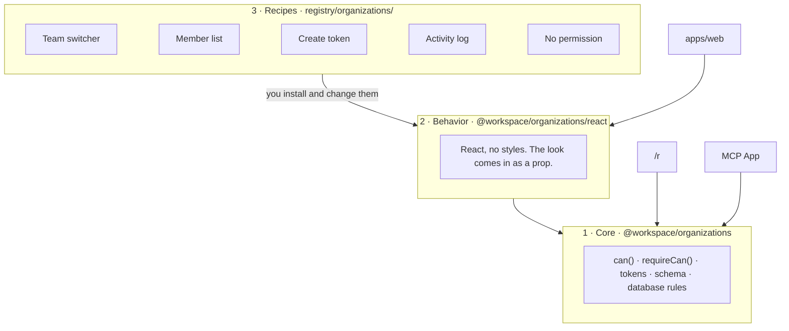
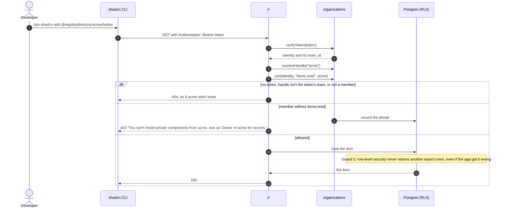

# `packages/organizations`

Teams and access for the registry.directory Dashboard. It answers one question
everywhere it's asked: **can this identity do this to this resource?**

> **Draft.** We're still designing, and this file gets rewritten as decisions
> close. No code yet.

## It plugs into your design system; it doesn't compete with it

1. **The core, with no React.** Logic, schema, database rules, tokens,
   `can()` and `requireCan()`. `/r`, the MCP App and scripts use it without
   loading React.
2. **Behavior components, with React and no styles,** in a separate export,
   `@workspace/organizations/react`. They bring the behavior, not the look:
   you pass the visual piece as a prop. A `TeamSwitcher` knows which teams you
   have, switches between them and respects permissions, but takes the menu
   from you. They ship as part of the package, not through the registry,
   because they're logic and should update with it.
3. **Recipes, as shadcn registry items.** Each one builds a piece end to end
   on top of layers 1 and 2. Install one with
   `npx shadcn add @registrydirectory/organizations/<item>` and make it yours.
   The Dashboard uses these same recipes.

## What happens when you install a private component

Two guards stand between a request and a team's data: the app checks, and the
database checks again.

## Who can do what

**Permissions are a fixed, typed list in the code.** **Roles are data:** each
team has its own roles, and each role is a group of permissions from that
list. `can()` resolves role → permissions from the database, so any role works
the same way.

Every team is born with three system roles:

| Permission | Owner | Member | Viewer |
|---|:---:|:---:|:---:|
| `items:read` | ✓ | ✓ | ✓ |
| `items:save`, `items:mark` | ✓ | ✓ | |
| `rules:read`, `rules:write` | ✓ | ✓ | |
| `activity:read` | ✓ | ✓ | |
| `presets:write` | ✓ | | |
| `members:manage` | ✓ | | |
| `tokens:manage` | ✓ | | |
| `settings:write` | ✓ | | |

A **Viewer** sees and installs what the team has, for example to prepare a
demo with a client's brand, and nothing else. **Owner** can't be edited or
deleted: it always holds every team permission. Member and Viewer can't be
deleted either.

**Custom roles** come later, with their own interface: an Owner creates a role
by picking team permissions, for example a Manager who handles people, tokens
and presets. A custom role never includes platform permissions, and nobody can
grant a permission they don't hold.

Platform permissions come from one role, **Admin**, which belongs to the
platform, not to any team, and isn't stored with team roles:
`submissions:review`, `origins:read`, `home:edit` and `analytics:read`. No
team Owner can grant it; only another Admin or a database migration can.
"Admin" is reserved for the platform.

## What the core guarantees

- **Deny by default,** and every denial is recorded.
- **A token never outranks its creator.**
- **One team never sees another team's rows,** enforced by the database, not
  only the app.
- **A team is never left without an Owner,** and **the platform is never left
  without an Admin.**
- **The audit log can only grow.**

The full list of rules for changing this package is in
[`AGENTS.md`](AGENTS.md).

## What it doesn't do

- **Sign people in.** Identity comes from outside (Auth0) through an adapter.
- **Serve `/r`.** It verifies the token; `/r` serves the item.
- **Record product events.** That is [`packages/feedback`](../feedback).

## API

| Area | API |
|---|---|
| Check | `can(identity, permission, resource) → boolean`, `requireCan(...)` |
| Teams | `createTeam(userId)` creates a team with an automatic, neutral handle; `renameHandle(teamId, handle)`; `resolveHandle(handle) → teamId`, following aliases |
| Members | `addMember`, `removeMember`, `setRole` |
| Tokens | `createToken(teamId, scopes, expiresAt)` returns the secret once; `verifyToken(secret) → identity`; `revokeToken(id)` |
| Audit | `listActivity(teamId)` |

## Depends on and used by

- **Depends on:** Postgres (Neon) through Drizzle, and an identity adapter
  (Auth0).
- **Used by:** `apps/web` (Dashboard routes and actions), `/r` (private
  items) and the MCP App server. Later, the MCP App will also use `can()` on
  the connected token to decide which tools to offer, so an Owner gets the
  admin tools without leaving the chat.
